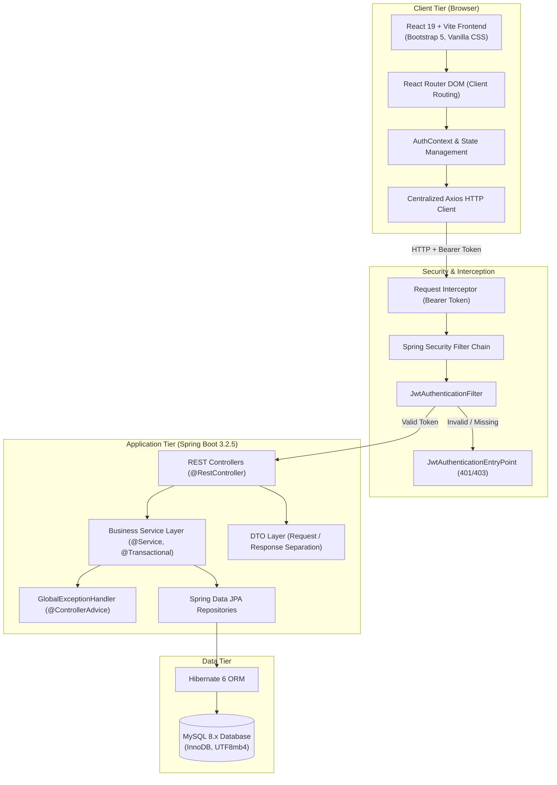
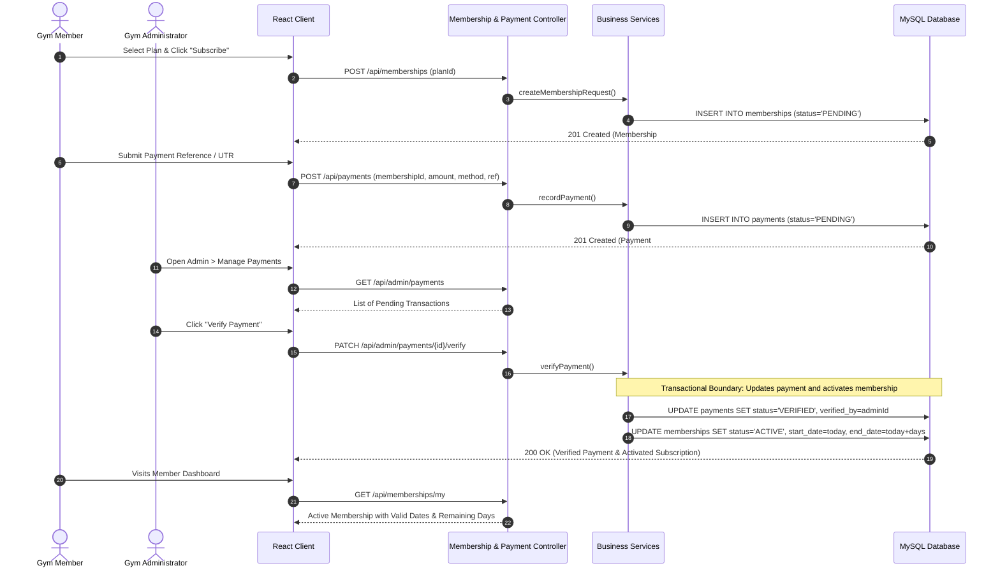

# System Architecture Documentation

## Smart Gym Management and Membership Tracking System

This document outlines the layered full-stack architectural design, security boundaries, and data flow sequences for the Smart Gym application.

---

### 1. High-Level System Architecture

---

### 2. End-to-End Membership & Payment Activation Flow

---

### 3. Role-Based Access Control (RBAC) Matrix

| Resource / Endpoint | Public | MEMBER | TRAINER | ADMIN |
|---|:---:|:---:|:---:|:---:|
| `/api/auth/register`, `/login` | ✅ | ❌ | ❌ | ❌ |
| `/api/membership-plans` (View) | ✅ | ✅ | ✅ | ✅ |
| `/api/membership-plans` (CRUD) | ❌ | ❌ | ❌ | ✅ |
| `/api/members/me` (Profile) | ❌ | ✅ | ❌ | ❌ |
| `/api/attendance/check-in` | ❌ | ✅ (Active Only) | ❌ | ❌ |
| `/api/attendance/my` | ❌ | ✅ | ❌ | ❌ |
| `/api/admin/attendance/**` | ❌ | ❌ | ❌ | ✅ |
| `/api/trainers/workout-plans/**` | ❌ | ❌ | ✅ (Assigned only)| ❌ |
| `/api/members/me/workout-plans` | ❌ | ✅ (Read only) | ❌ | ❌ |
| `/api/training-sessions` (Book) | ❌ | ✅ | ❌ | ❌ |
| `/api/trainers/me/sessions` | ❌ | ❌ | ✅ | ❌ |
| `/api/admin/dashboard` | ❌ | ❌ | ❌ | ✅ |

---

### 4. Concurrency & Integrity Safeguards

1. **Duplicate Check-In Safeguard**:
   - `attendances` table holds a unique composite key `(member_id, attendance_date)`. If two simultaneous requests arrive, the second request fails at the database constraint level and is handled gracefully by Spring's `ConflictException`.
2. **Session Slot Overlap Safeguard**:
   - Before confirming or booking a training session, `TrainingSessionRepository` queries existing non-cancelled sessions for that trainer on the requested date and time interval:
     `startTime < existingEndTime AND endTime > existingStartTime`.
3. **Audit History Safeguard**:
   - Memberships, trainer allocations, and workout plans maintain active flags and historical dates rather than physical hard deletes.
