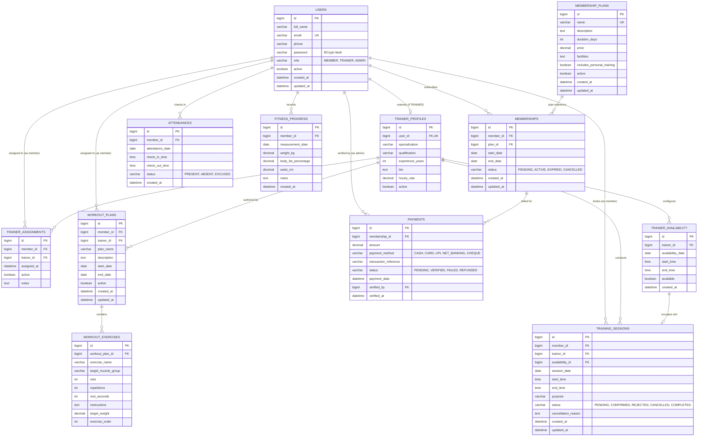

# Entity-Relationship (ER) Diagram

## Smart Gym Management and Membership Tracking System

Below is the comprehensive Entity-Relationship Diagram detailing the 12 core relational entities, their primary keys, foreign key associations, fields, and cardinality.

---

## Database Key Constraints & Invariants

1. **Unique Email Constraint**:
   - `users(email)` is strictly unique. No duplicate accounts can exist.
2. **One Check-In Per Day Rule**:
   - `attendances(member_id, attendance_date)` has a database unique constraint `uk_member_date`. Prevents duplicate attendance logging.
3. **Trainer Profile Relationship**:
   - `trainer_profiles(user_id)` is a unique one-to-one foreign key mapping back to `users(id)`.
4. **Subscription Period Integrity**:
   - Membership validity dates (`start_date` and `end_date`) are calculated deterministically: `end_date = start_date.plusDays(durationDays)`.
5. **Audit Preservations**:
   - When a membership or trainer assignment is deactivated, rows are preserved with `status = CANCELLED` or `active = false` to retain chronological business history.
